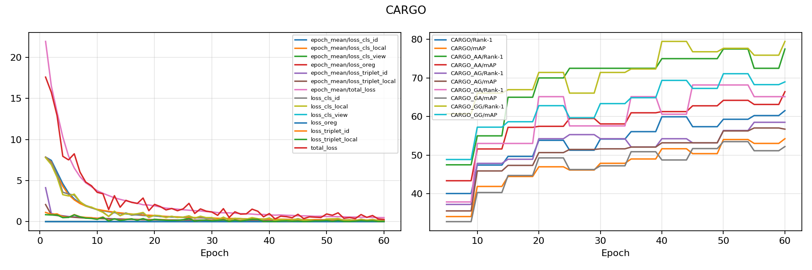
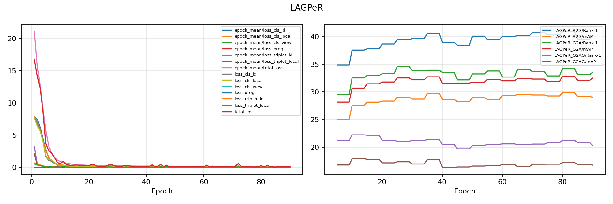

# SeCap-AGPReID: Independent Reproduction

Independent reproduction of SeCap for aerial-ground person re-identification, run on Kaggle with two Tesla T4 GPUs.

## Reproduction results

The CARGO model was trained for **60 epochs**. Reviewable plots, exact configurations, metrics, launch commands, and data-integrity records are versioned in [results/reproduction](results/reproduction/).

For model checkpoints, contact [rizzwanabdullah@gmail.com](mailto:rizzwanabdullah@gmail.com).

### CARGO

| Protocol | Rank-1 | mAP |
| --- | ---: | ---: |
| Overall CARGO | 61.54 | 54.26 |
| Aerial → Ground | 58.51 | 56.73 |
| Ground → Aerial* | 65.15 | 52.22 |
| Aerial → Aerial | 77.50 | 66.44 |
| Ground → Ground | 79.46 | 68.98 |

\*Ground → Aerial is reported as a supplementary reverse-direction measurement. The training input contained 1,660 unreadable CARGO training files; they were deterministically recorded and excluded. Query/gallery files were not changed.

### LAGPeR

| Protocol | Rank-1 | mAP |
| --- | ---: | ---: |
| Aerial → Ground | 40.97 | 29.83 |
| Ground → Aerial | 34.21 | 32.86 |
| Ground → Aerial + Ground | 21.27 | 17.21 |

## Architecture

## Sample aerial-ground data views

## Reproduce the run

The reproducible Kaggle notebook, runtime setup, checkpointing, and monitoring instructions are in [kaggle/README.md](kaggle/README.md). The notebook source is [kaggle/notebook/secap_reproduction.ipynb](kaggle/notebook/secap_reproduction.ipynb).

## Attribution

This reproduction is based on the SeCap method and the codebase it accompanies. Please cite the original SeCap work when using or comparing against this implementation.
