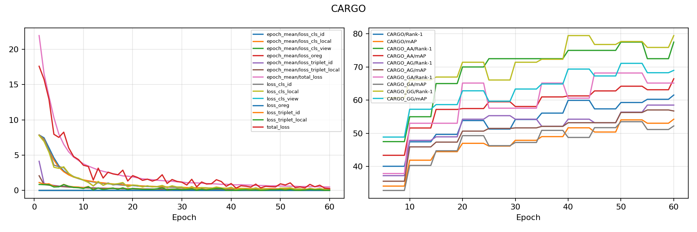

# CARGO result snapshot: epoch 60

This is the durable, reviewable snapshot of the CARGO run stopped at epoch 60/90. The authoritative large checkpoint archive is private at [Kaggle](https://www.kaggle.com/datasets/rizwanabdullah05/secap-reproduction-artifacts).

## Best checkpoint evaluation

| Protocol | Rank-1 | Rank-5 | Rank-10 | mAP | mINP |
| --- | ---: | ---: | ---: | ---: | ---: |
| CARGO | 61.54 | 75.00 | 81.09 | 54.26 | 40.17 |
| CARGO_AG | 58.51 | 78.72 | 85.11 | 56.73 | 46.32 |
| CARGO_GA (supplementary) | 65.15 | 80.30 | 84.85 | 52.22 | 32.20 |
| CARGO_AA | 77.50 | 82.50 | 87.50 | 66.44 | 51.70 |
| CARGO_GG | 79.46 | 86.61 | 91.07 | 68.98 | 55.14 |

`CARGO_AG` is the cross-view aerial-to-ground protocol in the released CARGO configuration. `CARGO_GA` is an additional reverse-direction measurement, clearly separated from official-comparison results.

## Integrity and scope

The CARGO input included 1,660 unreadable training files. The exact list is preserved in [`CARGO-data-integrity.json`](CARGO-data-integrity.json) and those training files were excluded deterministically. Query/gallery files were not modified. The run was intentionally stopped at epoch 60, so these numbers should be cited as an epoch-60 partial reproduction result, not as a completed 90-epoch or paper-reproduction result.
