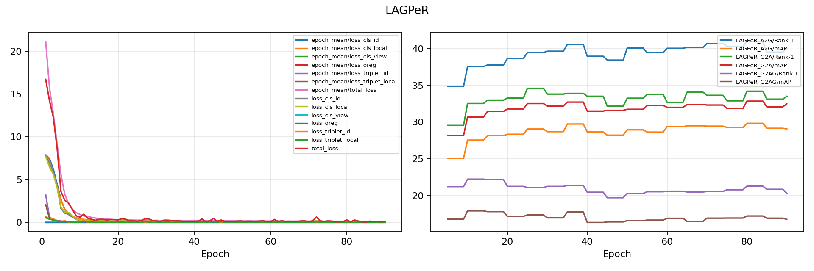

# LAGPeR result snapshot

| Protocol | Rank-1 | Rank-5 | Rank-10 | mAP | mINP |
| --- | ---: | ---: | ---: | ---: | ---: |
| Aerial → Ground | 40.97 | 55.71 | 63.07 | 29.83 | 11.70 |
| Ground → Aerial | 34.21 | 48.03 | 55.42 | 32.86 | 23.71 |
| Ground → Aerial + Ground | 21.27 | 32.37 | 39.86 | 17.21 | 6.93 |

The accompanying files preserve the training plot, metrics, configuration, launch metadata, and best evaluation. For checkpoint access, contact [rizzwanabdullah@gmail.com](mailto:rizzwanabdullah@gmail.com).
